# Correct Answers, Incorrect Reasoning: Does Distilled CoT Correctness Matter for Model Post-Training in Molecule Generation?

Anonymous code and data for the submission. This repository contains **MolCoT-Paired-4K**, a paired dataset of
original (distilled) and expert-curated chain-of-thought (CoT) traces for text-to-molecule generation, the training
code for supervised fine-tuning (SFT) and GRPO, the evaluation code, and the figures and result tables of the paper.

<p align="center">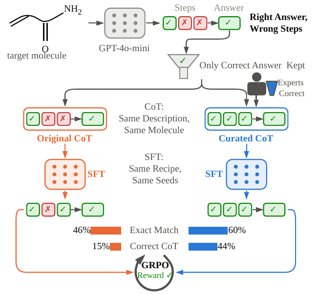</p>

**Right answer, wrong steps.** Distilled CoT examples are kept when their final molecule is correct, yet only 8% of
them are fully chemically correct. We pair each original CoT with a curated counterpart and fine-tune models on
either one under the same recipe and seeds.

## Contents

- [Overview](#overview)
- [MolCoT-Paired-4K](#molcot-paired-4k)
- [Repository layout](#repository-layout)
- [Setup](#setup)
- [Training and evaluation](#training-and-evaluation)
- [Results](#results)
- [Settings](#settings)
- [License](#license)

## Overview

<p align="center">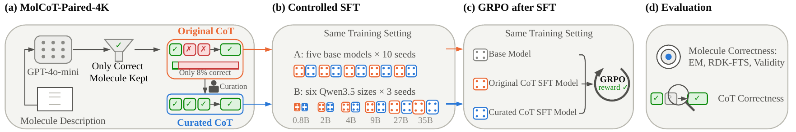</p>

(a) MolCoT-Paired-4K pairs every distilled CoT with its expert-curated version. (b) Controlled SFT: the same
recipe and seeds on Original or Curated CoT, for five base models of comparable size (10 seeds each) and six
Qwen3.5 sizes from 0.8B to 35B (3 seeds each). (c) GRPO after SFT, starting from the base model, the Original-CoT
SFT model or the Curated-CoT SFT model. (d) Evaluation of the generated molecules (exact match, validity,
fingerprint similarity) and of the correctness of the generated CoT.

## MolCoT-Paired-4K

| | |
|---|---|
| Examples | 4,213 description-molecule pairs, each with an Original and a Curated CoT |
| Splits | 3,369 train / 422 validation / 422 test |
| Sources | training splits of ChEBI-20, SMolInstruct and L+M-24 |
| Original CoT | distilled from GPT-4o-mini, kept when the final molecule matched the reference |
| Curated CoT | expert-corrected version of the same trace (every wrong step fixed) |
| Expert labels of the Original CoT | 1 Ineffective 0.8% · 2 Main-structure issue 26.9% · 3 Element issue 23.5% · 4 Minor issue 40.6% · 5 Correct 8.2% |

<p align="center"> </p>

Files, fields, label definitions, the construction steps and the curation tool are described in
[data/README.md](data/README.md).

## Repository layout

```
data/                      MolCoT-Paired-4K (six split files + a paired view), see data/README.md
sft/train_sft.py           LoRA SFT + test evaluation after every epoch (greedy and 16 samples)
sft/run_sft.sh             one SFT run with the settings of the paper (model families / model scales)
sft/train_sft_nf4.py       the same for Qwen3.5-27B with 4-bit NF4 base weights
grpo/train_grpo.py         GRPO after SFT (TRL + colocated vLLM), with evaluations before/after SFT and per GRPO epoch
grpo/run_grpo.sh           one GRPO run with the settings of the paper
eval/score_predictions.py  exact match / validity / similarity and pass@1-16 from prediction files
eval/prepare_external_testsets.py, eval/run_external_eval.sh, eval/external_unseen_em.py
                           ChEBI-20 and SMolInstruct test sets
scripts/make_nocot_data.py data folder of the direct-answer (No-CoT) SFT baseline
scripts/build_paired_file.py (to be released upon paper acceptance)
figures/                   the figures of the paper (PDF + PNG); figures/appendix/ for the appendix
results/                   the numbers behind the figures (CSV), see results/README.md
```

## Setup

SFT and evaluation (Python 3.12, one CUDA GPU per run):

```bash
pip install torch==2.11.0 --index-url https://download.pytorch.org/whl/cu128
pip install -r requirements.txt
```

GRPO uses a separate environment, because vLLM pins its own PyTorch version:

```bash
pip install -r requirements-grpo.txt
```

Base models are loaded from the Hugging Face Hub: `Qwen/Qwen3-4B-Base`, `mistralai/Ministral-3-3B-Base-2512`,
`meta-llama/Llama-3.2-3B`, `google/gemma-4-E4B`, `Qwen/Qwen3.5-{0.8B,2B,4B,9B}-Base`, `Qwen/Qwen3.5-27B`,
`Qwen/Qwen3.5-35B-A3B`. All runs of the paper used one 141 GB GPU each; peak memory per run (training plus all
evaluations) is about 50-70 GB for the models up to 9B and about 105 GB for Qwen3.5-35B-A3B.

## Training and evaluation

### SFT

```bash
# bash sft/run_sft.sh <families|scales> <model> <original|curated> <run_id>
GPU=0 bash sft/run_sft.sh families qwen3-4b curated 0          # model families: run_id 0-9
GPU=0 bash sft/run_sft.sh scales qwen3.5-9b original 2         # model scales:   run_id 0-2
NO_WANDB=1 GPU=0 bash sft/run_sft.sh scales qwen3.5-4b curated 0
```

Models: `families` = `qwen3-4b`, `ministral-3b`, `llama-3.2-3b`, `gemma-4-e4b`, `qwen3.5-4b`;
`scales` = `qwen3.5-0.8b`, `qwen3.5-2b`, `qwen3.5-4b`, `qwen3.5-9b`, `qwen3.5-27b`, `qwen3.5-35b-a3b`.
Run `run_id` uses training seed 1000 + id and evaluation seed 2000 + id, so the Original and Curated runs with the
same id see the same data order and the same sampling seeds.

Each run writes `runs/<model>/<variant>/run_<id>/`:

- `test_predictions_epoch_000.json` (before training) ... `test_predictions_epoch_004.json`: for each of the 422 test
  records the greedy answer and 16 sampled answers (temperature 1.0, top-p 0.9, top-k 50, at most 768 new tokens);
- `model/`: LoRA checkpoints; the epoch-4 adapter is the last checkpoint (`checkpoint-844` for an effective batch
  of 16);
- `test_predictions.json`: the epoch with the lowest validation loss (not used in the paper, which reports epoch 4).

### Scoring

```bash
python eval/score_predictions.py runs/qwen3.5-4b-base/ --out scores.csv
```

One row per prediction file with exact match (EM, RDKit-canonical SMILES), validity (RDKit can parse the answer) and
fingerprint similarity (Tanimoto of Morgan radius-2 fingerprints), for the greedy answer, pass@1 (mean over the 16
samples) and pass@2/4/8/16 (unbiased estimators from the 16 samples). The `stored_*` columns use the answer rule of
the training script (last `<answer>` tag) and are the numbers in the figures; the `strict_*` columns only accept a
closed answer tag inside the model's own turn.

### GRPO

```bash
# start: curated | original (continues the epoch-4 SFT adapter of the same run id) | base (no SFT)
GPU=0 bash grpo/run_grpo.sh curated 0
GPU=0 bash grpo/run_grpo.sh base 0
```

Qwen3.5-4B, 2 epochs, learning rate 1e-5, 8 completions per prompt, reward = exact match + 0.25 × format. The SFT
adapters come from `bash sft/run_sft.sh scales qwen3.5-4b <variant> <run_id>`. Results are written to
`runs_grpo/qwen3.5-4b-base/<start>/run_<id>/`, with test evaluations before SFT, after SFT and after each GRPO epoch.

### External test sets

```bash
python eval/prepare_external_testsets.py --chebi20-test <ChEBI-20>/test.txt \
    --smolinstruct-mg-test <SMolInstruct>/raw/test/molecule_generation.jsonl
GPU=0 bash eval/run_external_eval.sh data_external/chebi20 runs/qwen3.5-4b-base/curated/run_000/model/checkpoint-844 sft_curated 0
python eval/external_unseen_em.py runs_external/chebi20/sft_curated/curated/run_000/test_predictions.json
```

The two test sets are not redistributed here. `external_unseen_em.py` reports strict greedy exact match on the
records whose molecule does not occur in the MolCoT-Paired-4K training split.

### No-CoT baseline

```bash
python scripts/make_nocot_data.py --out data_nocot      # target "<answer>SMILES</answer>" instead of the CoT
GPU=0 DATA_DIR=$PWD/data_nocot bash sft/run_sft.sh scales qwen3.5-4b original 0
```

## Results

All numbers are exact match (%) on the 422-record test split unless stated otherwise; pass@1 is the mean over 16
samples, pass@16 the unbiased estimate. Tables with means, standard deviations and confidence intervals are in
[results/](results/).

### RQ1: CoT correctness across model families

<p align="center">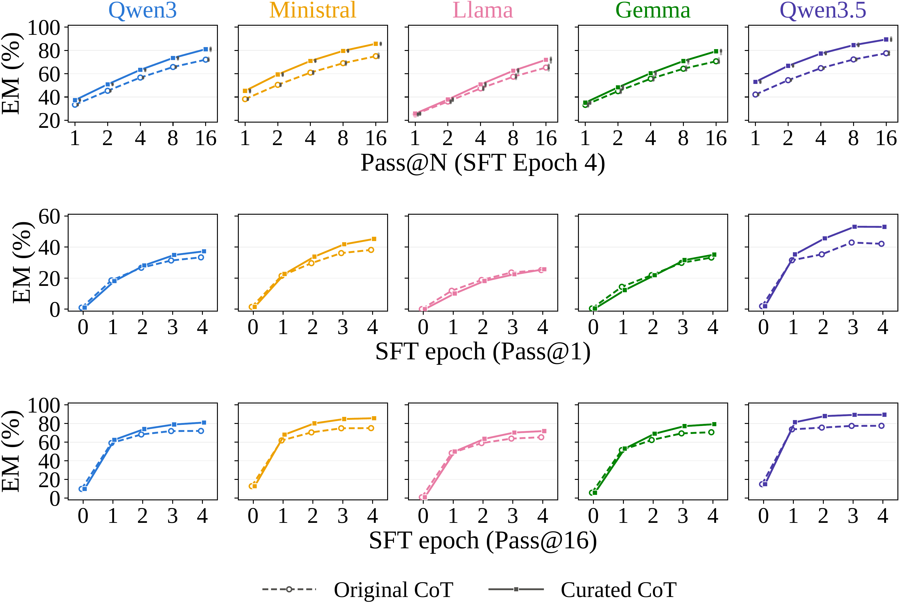</p>

Top row: epoch-4 EM against pass@N. Middle and bottom rows: EM across SFT epochs at pass@1 and pass@16.

| Model (epoch 4, 10 seeds) | Original pass@1 | Curated pass@1 | Original pass@16 | Curated pass@16 |
|---|---:|---:|---:|---:|
| Qwen3-4B | 33.4 | **37.3** | 72.1 | **81.1** |
| Ministral-3B | 38.2 | **45.2** | 75.1 | **85.7** |
| Llama-3.2-3B | 25.2 | **25.7** | 65.3 | **71.9** |
| Gemma-4-E4B | 33.2 | **35.2** | 70.7 | **79.3** |
| Qwen3.5-4B | 42.1 | **53.0** | 77.6 | **89.4** |

The advantage of Curated-CoT SFT grows with N:

<p align="center">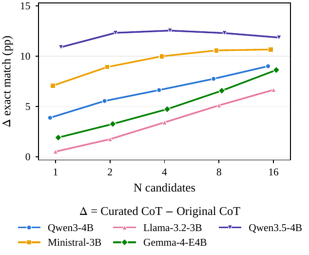</p>

### RQ2: CoT correctness across model scales

<p align="center">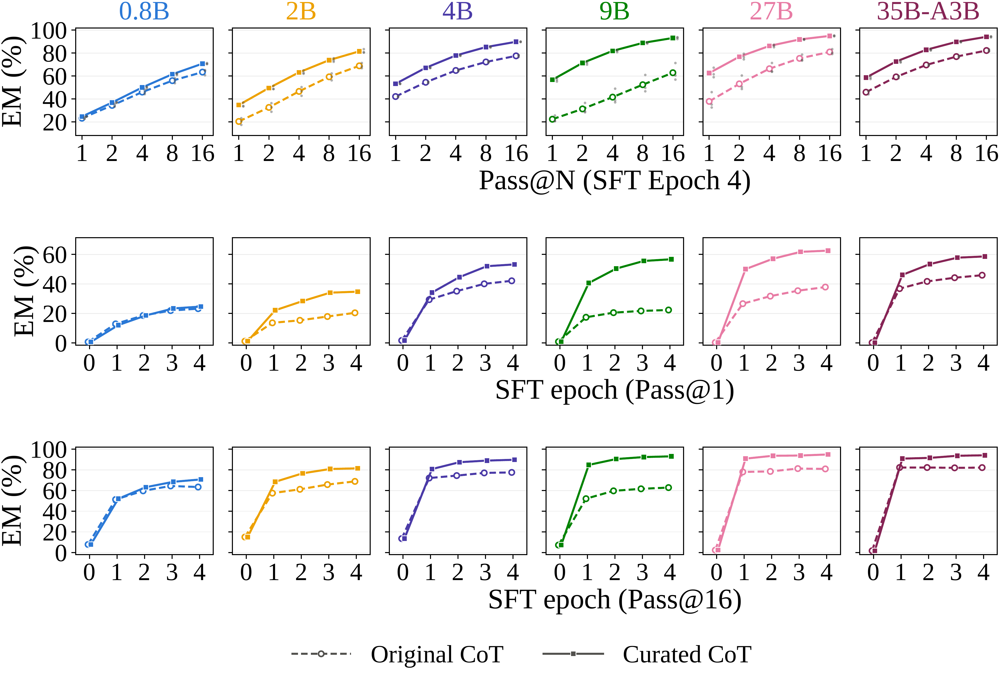</p>

| Qwen3.5 (epoch 4, 3 seeds) | Original pass@1 | Curated pass@1 | Original pass@16 | Curated pass@16 |
|---|---:|---:|---:|---:|
| 0.8B | 23.3 | **24.7** | 63.4 | **70.8** |
| 2B | 20.4 | **34.8** | 68.9 | **81.5** |
| 4B | 42.1 | **53.2** | 77.6 | **89.8** |
| 9B | 22.4 | **56.7** | 62.9 | **93.1** |
| 27B | 37.9 | **62.6** | 81.0 | **94.9** |
| 35B-A3B | 45.9 | **58.6** | 82.2 | **94.2** |

### RQ3: Does the effect persist after GRPO?

<p align="center">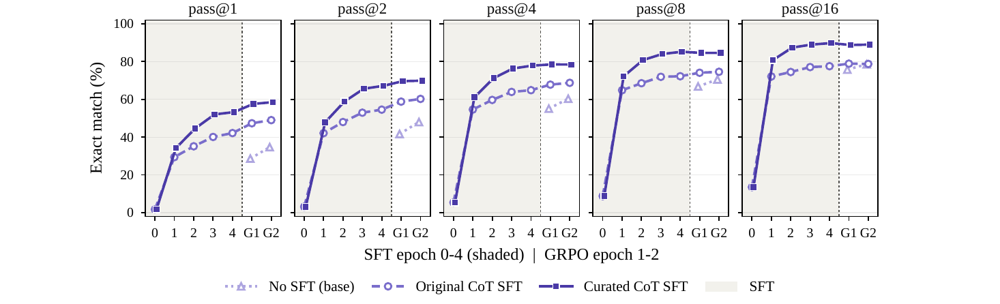</p>

The shaded region is SFT (epochs 0-4), followed by two GRPO epochs (G1, G2).

| Qwen3.5-4B (3 seeds) | pass@1 start | pass@1 after GRPO | pass@16 start | pass@16 after GRPO |
|---|---:|---:|---:|---:|
| Base (no SFT) → GRPO | 1.7 | 34.7 | 13.5 | 78.6 |
| Original-CoT SFT → GRPO | 42.1 | 49.0 | 77.6 | 78.8 |
| Curated-CoT SFT → GRPO | 53.2 | **58.5** | 89.8 | **89.0** |

### RQ4: Correctness of the generated CoT

<p align="center">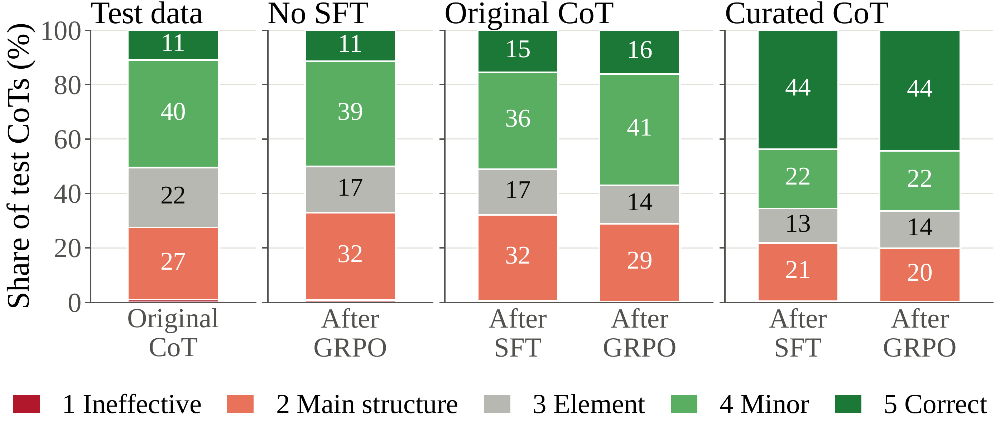</p>

Labels (1-5, as in the dataset) of the CoT generated by the Qwen3.5-4B models on the 422 test records. Fully correct
CoT: 44% after Curated-CoT SFT vs 15% after Original-CoT SFT; 44% vs 16% after GRPO; 11% for the base model after
GRPO.

### External test sets

Qwen3.5-4B, strict greedy exact match on molecules unseen in the MolCoT-Paired-4K training split (3 seeds):

| Model | ChEBI-20 test | SMolInstruct test |
|---|---:|---:|
| Base | 0.0 | 0.0 |
| Original-CoT SFT | 3.7 | 2.2 |
| Curated-CoT SFT | **6.2** | **4.1** |
| Original-CoT SFT → GRPO | 4.6 | 2.8 |
| Curated-CoT SFT → GRPO | **6.7** | **4.5** |

### Appendix figures

<details>
<summary>Training curves and all metrics (click to expand)</summary>

SFT training curves, model families and model scales:
<p align="center">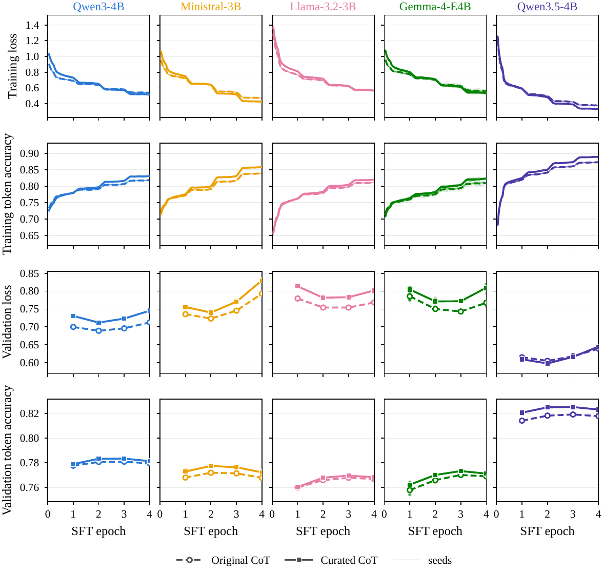</p>
<p align="center">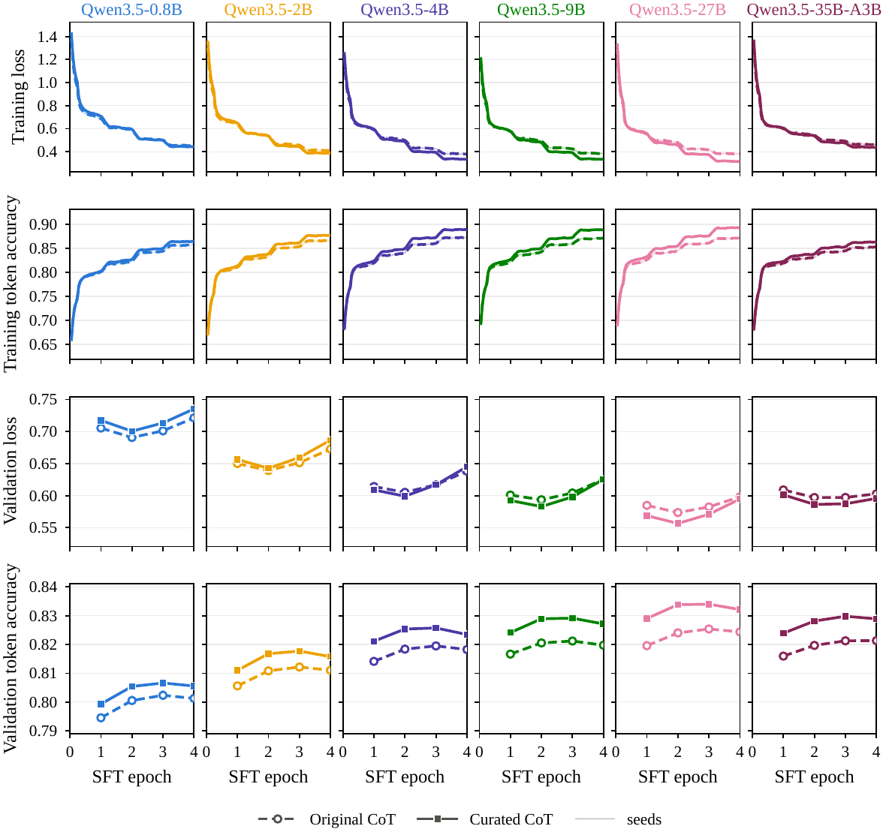</p>

GRPO training curves:
<p align="center">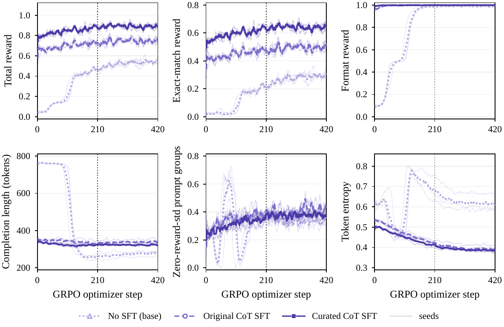</p>

EM, validity and similarity against pass@N at epoch 4 (model families, model scales):
<p align="center">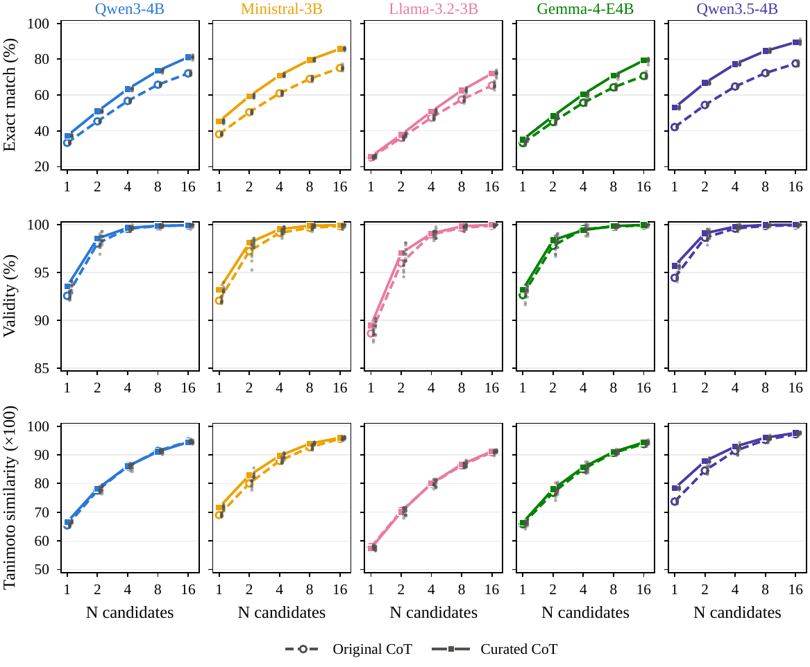</p>
<p align="center">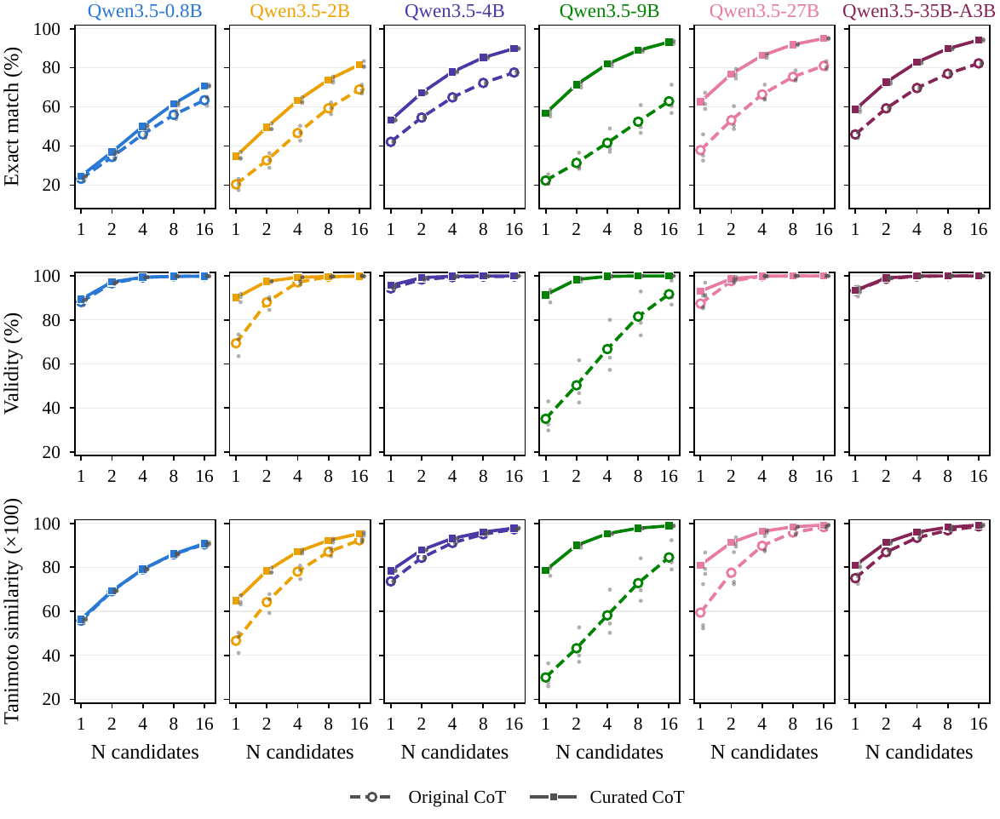</p>

Across SFT epochs at pass@1 and pass@16 (model families):
<p align="center">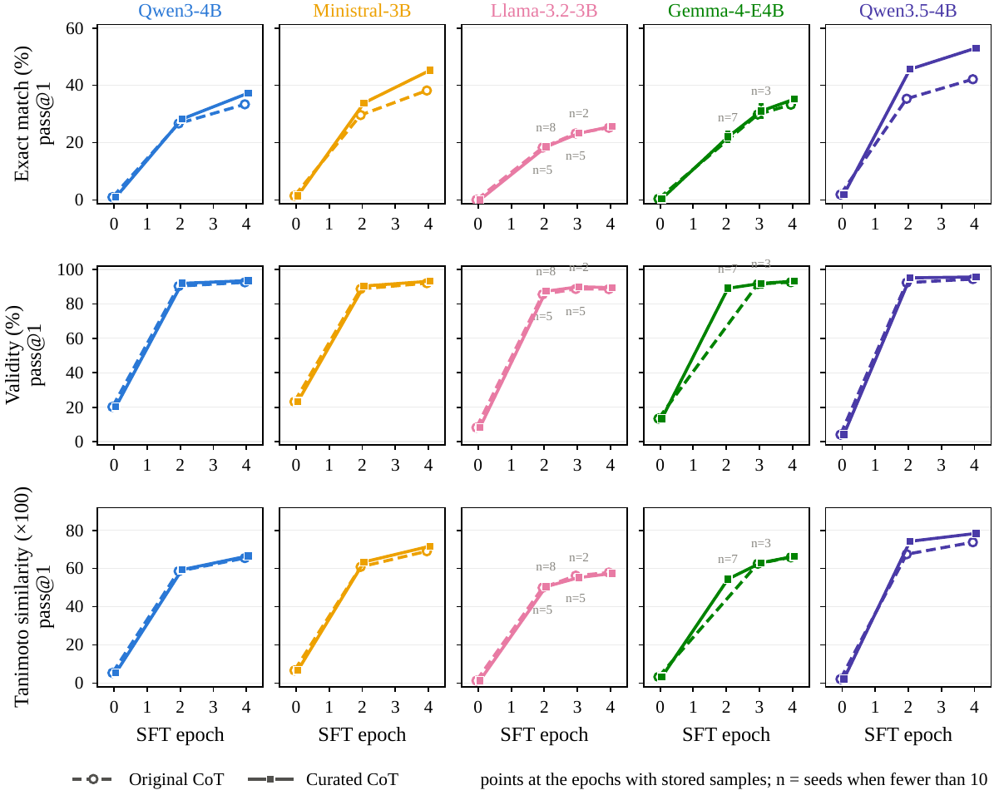</p>
<p align="center">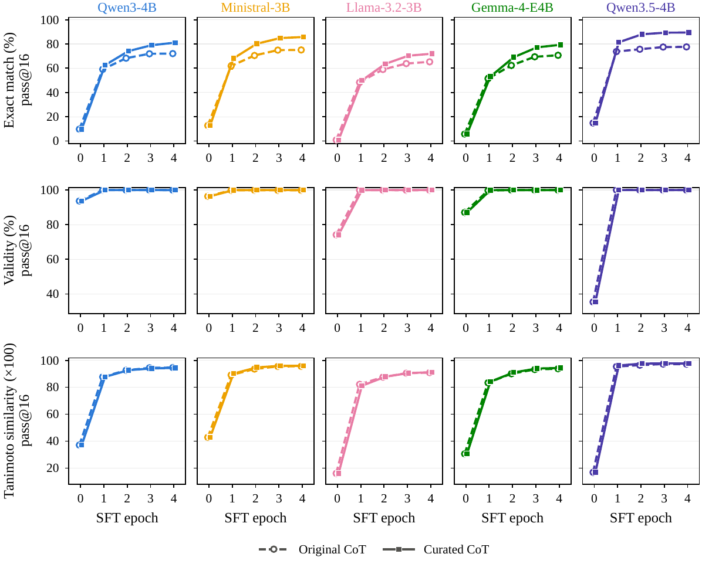</p>

Across SFT epochs at pass@1 and pass@16 (model scales):
<p align="center">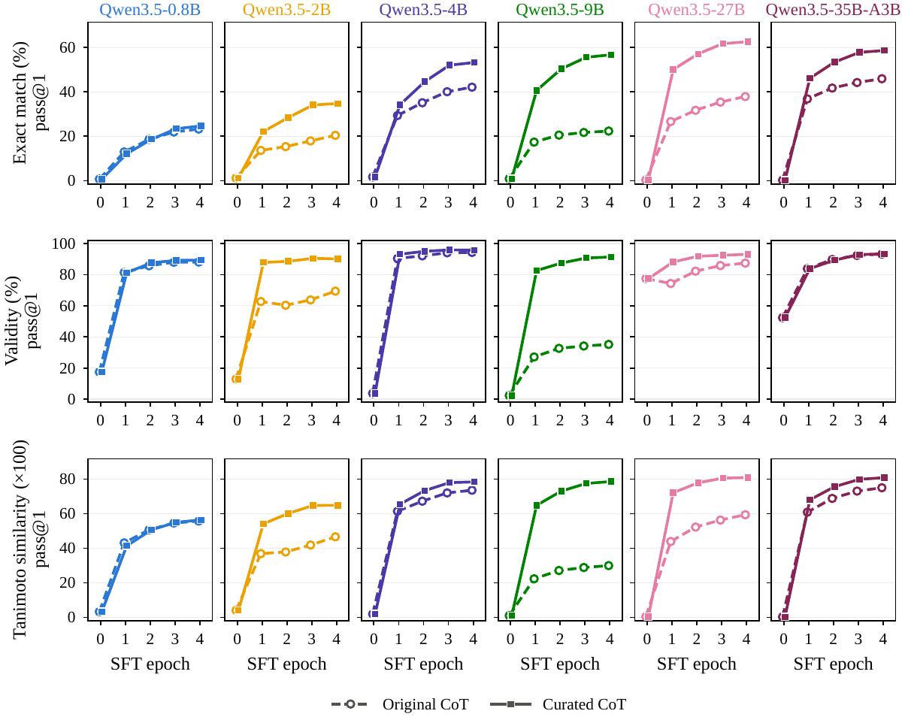</p>
<p align="center">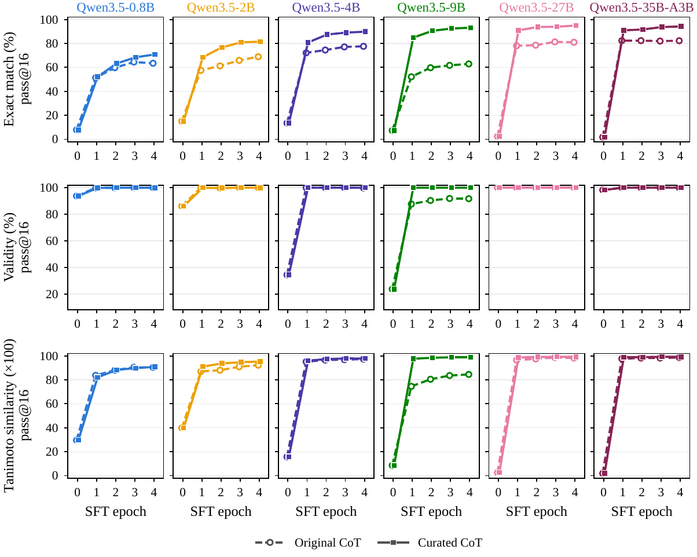</p>

EM against pass@N after the second GRPO epoch:
<p align="center">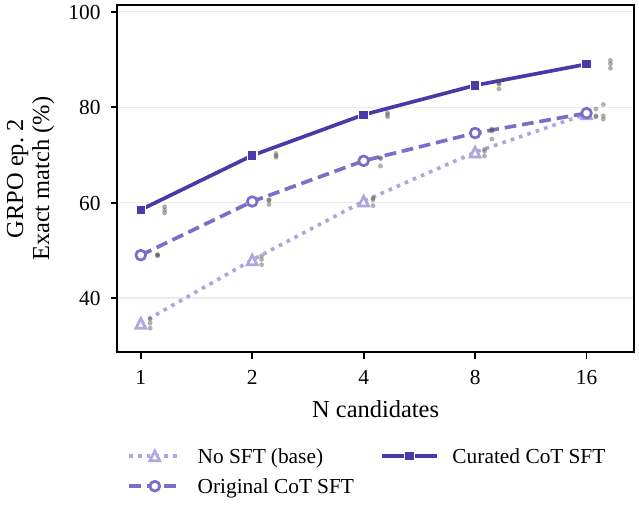</p>

</details>

## Settings

| Setting | SFT, model families | SFT, model scales | GRPO |
|---|---|---|---|
| Training examples | 3,369 | 3,369 | 3,369 |
| Epochs | 4 | 4 | 2 |
| LoRA rank / alpha / dropout | 16 / 32 / 0.05 | 16 / 32 / 0.05 | 16 / 32 / 0.05 |
| Learning rate | 2e-4 | 2e-4 | 1e-5 |
| Optimizer, schedule | AdamW, cosine | AdamW, cosine | AdamW, cosine |
| Warm-up ratio | 3% | 3% | 3% |
| Gradient clipping | 0.3 | 0.3 | 0.3 |
| Effective batch | 16 | 16 | 16 prompts |
| Max. sequence length | 1,280 | 1,280 | 768 (completion) |
| Seeds | 10 | 3 | 3 |
| Samples per prompt | – | – | 8 |
| GRPO clip ε / KL coefficient | – | – | 0.2 / 0 |
| Prompt format | plain text (Qwen3.5: chat template) | chat template | chat template |
| Evaluation decoding | greedy + 16 samples (T 1.0, top-p 0.9, top-k 50), ≤ 768 new tokens | same | same |

The model-family runs of the paper drew one sample per `generate` call; the released script draws the 16 samples of a
prompt in one call (`--gen-batch-size`), which samples from the same distribution and is several times faster.

## License

Code: MIT (see [LICENSE](LICENSE)). Data: CC BY 4.0 (see [data/README.md](data/README.md)).
