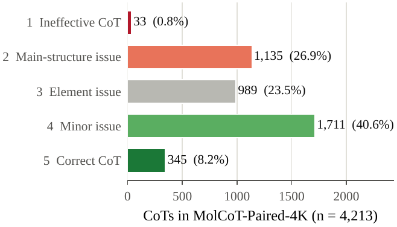
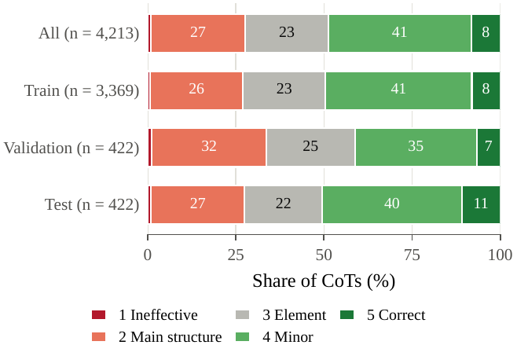
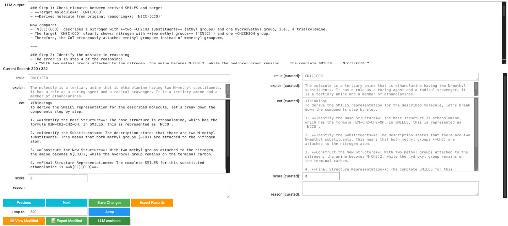

# MolCoT-Paired-4K

4,213 description-to-molecule examples, each with two chain-of-thought (CoT) traces that lead to the same target
molecule:

- **Original CoT**: distilled from GPT-4o-mini (the trace was kept because the teacher's final molecule matched the
  reference);
- **Curated CoT**: the same trace after expert review; every chemically wrong step is corrected, correct traces are
  kept unchanged.

Description, target SMILES and split are identical for the two CoT variants, so training on one or the other isolates
the effect of CoT correctness.

## Files

| File | Records | Content |
|---|---:|---|
| `train_data.jsonl`* / `val_data.jsonl` / `test_data.jsonl` | 3,369 / 422 / 422 | Original CoT |
| `curated_train_data.jsonl`* / `curated_val_data.jsonl` / `curated_test_data.jsonl` | 3,369 / 422 / 422 | Curated CoT |
| `molcot_paired_4k.jsonl`* | 4,213 | Both CoTs side by side (built by `scripts/build_paired_file.py`*) |

\* To be released upon paper acceptance.

The training code (`sft/train_sft.py`) reads the six split files and pairs Original and Curated records by
(description, SMILES), so both variants see the same records in the same order.

### Fields of the split files

| Field | Meaning |
|---|---|
| `explain` | Molecular description (the model input). |
| `smile` | Reference SMILES (the target). |
| `cot` | The CoT, ending with `<answer>SMILES</answer>`; this is the training target of the assistant turn. |
| `smile_hyp` | The SMILES the teacher model produced together with the original CoT. |
| `score` | Answer-filter flag of the distillation step (1.0 = kept). |
| `curation_score` | Expert label of the CoT (1-5, see below). In the Original files this is the label of the original trace; every Curated CoT has label 5. |
| `reason` | Curated files only: the curator's short note on the error that was corrected (free text, may be empty). |
| `pair_id` | Identifier shared by the Original and Curated record of a pair. |

### Fields of `molcot_paired_4k.jsonl`

`pair_id`, `split`, `description`, `smiles`, `original_cot`, `original_cot_answer` (= `smile_hyp`),
`original_cot_label` (expert label 1-5), `curated_cot`, `curation_note` (= `reason`).

## Expert labels of the Original CoT

| Label | Name | Definition | Share |
|---|---|---|---:|
| 1 | Ineffective CoT | Ineffective reasoning path: repeated descriptions, empty thinking, or the properties of the description repeated without reasoning. | 0.8% |
| 2 | Main-structure issue | The main structure is wrong, e.g. a ring reasoned as a linear chain or vice versa. | 26.9% |
| 3 | Element issue | Wrong element counts, e.g. a twelve-carbon chain reasoned as a ten-carbon chain. | 23.5% |
| 4 | Minor issue | Issues that do not change the main structure: missing stereochemistry, wrong bond orders (e.g. `C(=O)O` written as `OCO`), Kekulé vs aromatic form. | 40.6% |
| 5 | Correct CoT | Fully chemically correct; no revision needed. | 8.2% |

Only 8.2% (345) of the distilled traces are fully correct although all of them lead to the reference molecule.
The label distribution is similar in the three splits:

<p align="center"> </p>

Mean length: Original CoT 1,285.5 characters, Curated CoT 1,184.8 characters.

## Construction (summary)

1. Description-molecule pairs from the training splits of ChEBI-20, SMolInstruct and L+M-24 (243,411 pairs); pairs
   whose SMILES RDKit cannot parse or embed in 3D, and descriptions shorter than 20 words, are removed (55,236 left).
2. GPT-4o-mini is prompted five times per description for a CoT followed by a SMILES; a pair is kept when one of the
   answers matches the reference molecule (4,213 pairs).
3. Experts with university-level chemistry knowledge label every trace (labels above) and correct every trace that
   contains an error, with a dedicated curation tool:

<p align="center"></p>

4. Random 8 : 1 : 1 split into train / validation / test.

## Example (one row of `molcot_paired_4k.jsonl`, long strings abridged)

```json
{
  "pair_id": "18325103a0e0762ebae7", "split": "test",
  "description": "Acrylamide may decompose with heat and polymerize at temperatures above 84 °c, or exposure to light, releasing ammonia gas. The molecule has Odorless. ...",
  "smiles": "C=CC(N)=O",
  "original_cot": "To derive the SMILES representation for acrylamide based on the molecular description, we first need to analyze its structure. Acrylamide is an organic compound ... ...  the SMILES for acrylamide is:\n\n<answer>C=C(C(=O)N)</answer>",
  "original_cot_answer": "C=C(C(=O)N)",
  "original_cot_label": 2,
  "curated_cot": "To derive the SMILES representation for acrylamide based on the molecular description, we first need to analyze its structure. Acrylamide is an organic compound ... ... r, the SMILES for acrylamide is:\n\n<answer>C=CC(=O)N</answer>",
  "curation_note": "wrong branch"
}
```

## License

The data are released under the Creative Commons Attribution 4.0 license (CC BY 4.0). They are derived from
ChEBI-20, SMolInstruct and L+M-24; please also respect the terms of these source datasets. The original traces were
generated with GPT-4o-mini.
